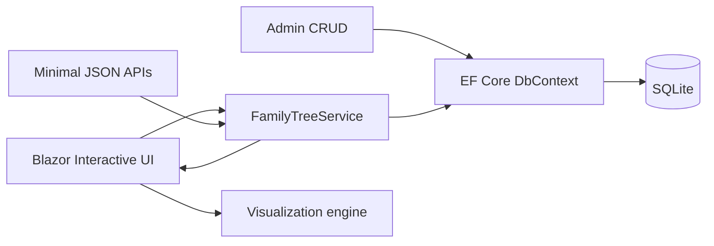

# FamilyTree

[](https://github.com/johnnysb160/FamilyTree-Showcase/actions/workflows/ci.yml)


FamilyTree is an interactive genealogy explorer built with Blazor. It renders the same relationship graph through three complementary visualizations and recalculates kinship labels from the point of view of any selected person.

> Every person, date, place, and relationship in this public repository is fictional. The private project and its real family history remain separate.

## Product snapshot


## What makes it interesting

- **Three visual models:** multidirectional navigation, ancestor/descendant treegraph, and traditional family tree.
- **Dynamic point of view:** choose any person as the focus and recalculate labels such as parent, sibling, uncle, cousin, and descendant.
- **Graph-aware relationships:** parents, children, siblings, registered spouses, and co-parents are represented without assuming marriage from shared children.
- **Interactive exploration:** search, focus navigation, details drawer, zoom, pan, and centered selection.
- **Administrative workflow:** create and edit relatives while preserving graph consistency.
- **API-first data:** flat and hierarchical JSON endpoints serve the same data used by the UI.
- **Local persistence:** EF Core migrations and SQLite provide a zero-service development experience.

## Architecture



[Read the architecture case study](docs/architecture.md)

## Visualization modes

| Mode | Best for |
|---|---|
| Multidirectional | Exploring parents, children, and siblings around the selected person |
| Treegraph | Following a focused ancestor or descendant line with sibling branches |
| Family tree | Understanding generations and household relationships at a glance |

## Technology

- .NET 10 and Blazor Interactive Server
- Entity Framework Core 10 and SQLite
- Minimal APIs
- JavaScript/SVG graph layout and interaction
- CSS-isolated reusable Blazor components
- xUnit graph and kinship tests

## Repository structure

```text
Components/          Pages, layouts, focus picker, details drawer
Data/                EF Core model, fictional seed, migrations
Services/            Graph queries, kinship calculation, photo storage
wwwroot/js/          Visualization layout and interaction
wwwroot/css/         Showcase styling
tests/               Graph and kinship tests
docs/                Architecture and privacy notes
```

## Run locally

Prerequisite: .NET 10 SDK.

```powershell
dotnet tool restore
dotnet restore FamilyTree.slnx
dotnet ef database update --project FamilyTree.csproj
dotnet run --project FamilyTree.csproj
```

Open the HTTPS URL displayed by ASP.NET Core. The database is local and seeded only with the fictional showcase family.

## API

```text
GET /api/family
GET /api/tree/{id}/ancestors
GET /api/tree/{id}/descendants
GET /api/tree/{id}/bidirectional
```

## Verify

```powershell
dotnet build FamilyTree.slnx --configuration Release
dotnet test FamilyTree.slnx --configuration Release --no-build
```

CI also applies the migrations to a fresh SQLite database to catch schema/seed failures.

## Privacy design

Real genealogical information is personal data. This public version therefore uses a clean history, fictional seed records, no uploaded photos, no private database, and no source documents. See [SECURITY.md](SECURITY.md).

## Source availability

This repository is published for portfolio review. No open-source license is granted unless a license file is added later.

