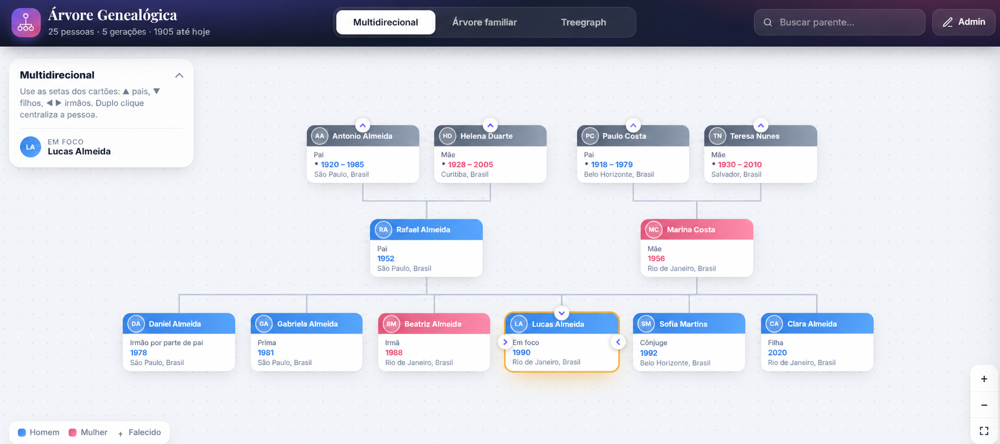
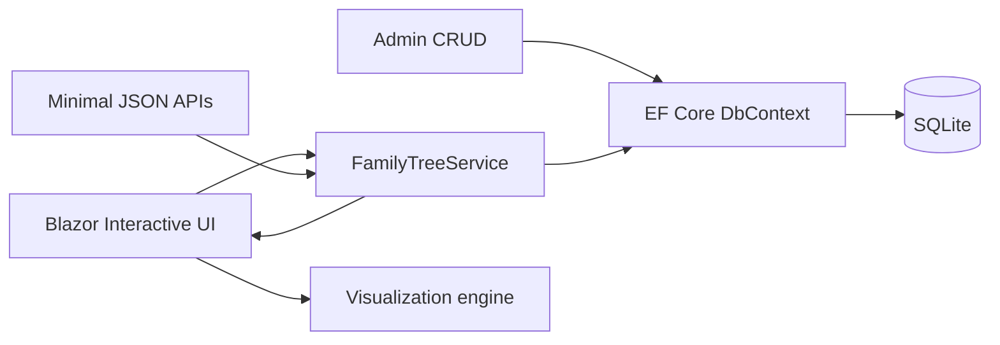

# FamilyTree

[](https://github.com/johnnysb160/FamilyTree-Showcase/actions/workflows/ci.yml)


FamilyTree is an interactive genealogy system that turns a connected family dataset into a navigable, point-of-view-aware graph. It renders the same people and relationships through three complementary visualizations, calculates how every person is related to the current focus, and provides the editing workflow needed to evolve the tree without hand-maintaining relationship labels.

> Every person, date, place, and relationship in this public repository is fictional. The private project and its real family history remain separate.

## Product snapshot



## Core user journey

1. **Find or choose any person.** Search accepts the family dataset, the selected focus is reflected in the URL, and the last choice can be restored locally for the next visit.
2. **Rebuild the tree around that point of view.** Parents, children, siblings, partners, co-parents, ancestors, and descendants are recalculated around the selected person.
3. **Switch visual models without changing the data.** Multidirectional exploration, animated lineage treegraph, and generation-based family tree all consume stable person identifiers from the same graph service.
4. **Navigate inside the graph.** Directional controls expand or collapse parents, children, and sibling branches; zoom, pan, fit, centered selection, and mobile compaction keep large trees usable.
5. **Inspect the human story.** A details drawer combines calculated kinship with names, dates, places, life events, occupation, notes, spouse/co-parent context, and direct navigation to related people.
6. **Maintain the dataset.** Administrative screens create or edit relatives, attach parents and spouses, upload photos outside source control, and offer relationship-aware shortcuts such as adding a child, spouse, or sibling from the current person.

## Product depth

| Area | Capabilities |
|---|---|
| Relationship engine | Nearest-common-ancestor traversal, ancestor-depth maps, gender-aware kinship, paternal/maternal context, descendants, cousins, spouses, and co-parents |
| Multidirectional view | Focus-centered cards with independent parent, child, and sibling navigation and direct recentering |
| Lineage treegraph | Animated Bézier hierarchy for ancestor or descendant branches, expand/collapse controls, and automatic fit |
| Family tree | Generation layout, household and partner connections, shared-child links, branch visibility controls, and responsive positioning |
| Person experience | Search, remembered focus, shareable focus URL, details drawer, life-event timeline, relation chips, photos, notes, and related-person navigation |
| Administration | Relative list, create/edit form, parent and spouse pickers, contextual add-relative flows, photo storage, and EF Core persistence |
| Integration surface | Flat family graph plus ancestor, descendant, and bidirectional Minimal API representations |
| Verification | Tests for traversal and kinship rules, fresh-database migration in CI, fictional seed validation, and a zero-service SQLite setup |

## What makes it interesting

- **Three visual models:** multidirectional navigation, ancestor/descendant treegraph, and traditional family tree.
- **Dynamic point of view:** choose any person as the focus and recalculate labels such as parent, sibling, uncle, cousin, and descendant.
- **Graph-aware relationships:** parents, children, siblings, registered spouses, and co-parents are represented without assuming marriage from shared children.
- **Interactive exploration:** search, focus navigation, details drawer, zoom, pan, and centered selection.
- **Administrative workflow:** create and edit relatives while preserving graph consistency.
- **API-first data:** flat and hierarchical JSON endpoints serve the same data used by the UI.
- **Local persistence:** EF Core migrations and SQLite provide a zero-service development experience.

## The graph problem behind the interface

Kinship is not stored as a brittle text field. For a selected pair, the service builds ancestor-depth maps, finds the nearest common ancestor, classifies the path, and only then applies generation, gender, and family-side wording. Explicit spouse links remain distinct from people who merely share a child, so the UI can represent spouses and co-parents without inventing a marriage.

## Architecture



[Read the architecture case study](docs/architecture.md)

## Visualization modes

| Mode | Best for |
|---|---|
| Multidirectional | Exploring parents, children, and siblings around the selected person |
| Treegraph | Following a focused ancestor or descendant line with sibling branches |
| Family tree | Understanding generations and household relationships at a glance |

## Technology

- .NET 10 and Blazor Interactive Server
- Entity Framework Core 10 and SQLite
- Minimal APIs
- JavaScript/SVG graph layout and interaction
- CSS-isolated reusable Blazor components
- xUnit graph and kinship tests

## Repository structure

```text
Components/          Pages, layouts, focus picker, details drawer
Data/                EF Core model, fictional seed, migrations
Services/            Graph queries, kinship calculation, photo storage
wwwroot/js/          Visualization layout and interaction
wwwroot/css/         Showcase styling
tests/               Graph and kinship tests
docs/                Architecture and privacy notes
```

## Run locally

Prerequisite: .NET 10 SDK.

```powershell
dotnet tool restore
dotnet restore FamilyTree.slnx
dotnet ef database update --project FamilyTree.csproj
dotnet run --project FamilyTree.csproj
```

Open the HTTPS URL displayed by ASP.NET Core. The database is local and seeded only with the fictional showcase family.

## API

```text
GET /api/family
GET /api/tree/{id}/ancestors
GET /api/tree/{id}/descendants
GET /api/tree/{id}/bidirectional
```

## Verify

```powershell
dotnet build FamilyTree.slnx --configuration Release
dotnet test FamilyTree.slnx --configuration Release --no-build
```

CI also applies the migrations to a fresh SQLite database to catch schema/seed failures.

## Privacy design

Real genealogical information is personal data. This public version therefore uses a clean history, fictional seed records, no uploaded photos, no private database, and no source documents. See [SECURITY.md](SECURITY.md).

## Source availability

This repository is published for portfolio review. No open-source license is granted unless a license file is added later.
