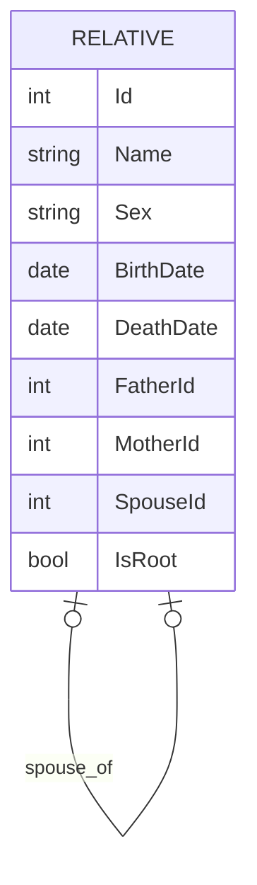
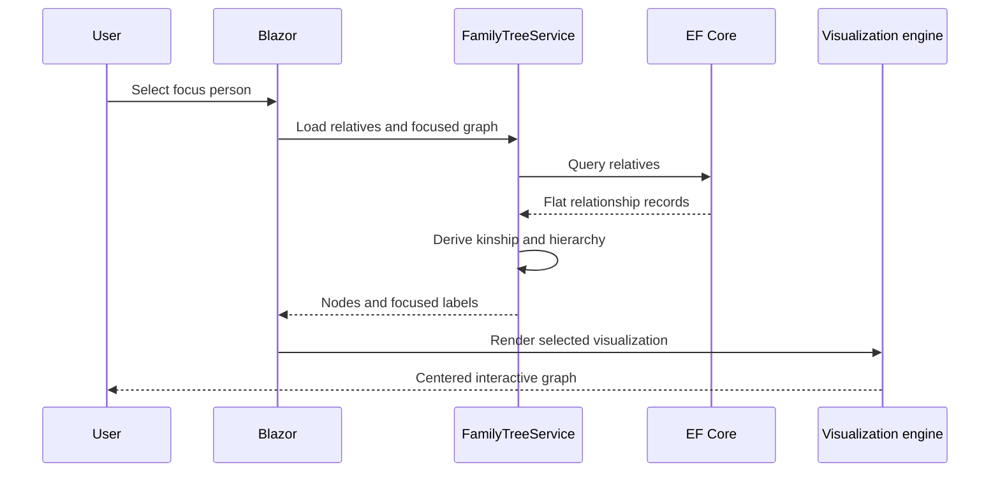

# Architecture case study

## Goal

The application must answer two different questions with one graph:

1. How are all people connected?
2. What is each person's relationship to the person currently in focus?

Storing free-text labels alone cannot solve the second question, so FamilyTree derives kinship from parent links and registered spouse links.

## Data model

Parent relationships form the blood graph. A spouse relationship is explicit and must not be inferred merely because two people share a child. Co-parents are presented separately.

## Request flow

## Kinship calculation

The service builds ancestor-depth maps for the focus person and the target person, finds their nearest common ancestor, and classifies the path into parent, child, sibling, uncle/aunt, nephew/niece, grandparent, descendant, or cousin relationships. Gender and paternal/maternal side are applied only after the structural relationship is known.

## Visualization boundary

Blazor owns data, focus state, navigation, and the details drawer. JavaScript owns layout, pan, zoom, connector geometry, and efficient SVG updates. Both receive the same stable node identifiers.

## Persistence

SQLite keeps the showcase self-contained. EF Core migrations create the schema and insert a fictional seed graph. Uploaded images are intentionally excluded from the public repository.

## Trade-offs

- A single `Relative` table keeps traversal simple but requires cycle protection during graph construction.
- Calculating kinship in memory is straightforward for a personal family graph; very large public graphs would require different indexing and pagination.
- JavaScript remains responsible for visualization mechanics while Blazor remains the source of application state.

